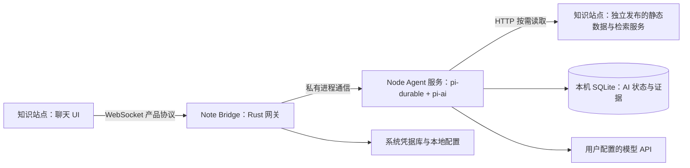

# Note Bridge：基于 Pi 的 Agent 与薄客户端方案

状态：已批准并进入实施。调研日期：2026-10-24。

实施修订：按用户最新要求采用全新聊天存储，不读取或导入旧浏览器聊天；网站与 bridge 使用 v2 协议，不保留 v1 agent 执行路径。现有配对授权和模型服务配置继续保留。

## 结论与约束

采用 Pi 的方向合适。对于「Agent 放到 bridge、AI 数据在 bridge 持久化、网页成为薄客户端」这个目标，有条件首选 **`@earendil-works/pi-durable` + `@earendil-works/pi-ai` + SQLite**，由 Tauri 管理一个随应用打包的 Node 子进程。

必须明确两种数据的归属：

- **知识内容的权威数据源仍是核心知识站点**：正文、目录、TOC、知识网络、相关文档和检索索引由站点构建、托管、独立发布。它们不进入 bridge 安装包，不要求 bridge 与站点同步发版，也不要求先完整下载知识库。
- **AI 业务状态归 bridge**：会话、消息、工具调用与结果、引用证据、附件快照、上下文摘要、模型选择、运行状态和用量都在 bridge 持久化。站点的聊天 UI 只查询和显示这些状态。

Bridge 读取站点数据时保存本次回答实际使用的证据，必要时使用有界 HTTP 缓存；这些是消费记录和缓存，不取代站点的数据源。本文中的「迁移文档工具」指迁移工具的定义、调度与执行，不是迁移文档发布位置。

## 为什么选择这一层 Pi

研究基线为 [Pi commit 136b87e8](https://github.com/earendil-works/pi/tree/136b87e8a7f5a3e5186de0289523ba327dc592fc)。源码包标记为 1.4.0，但包含 1.4.0 之后的 Unreleased 变更；本文核实的是该提交，不能直接认为 npm 1.4.0 具有完全相同 API。Pi 使用 MIT 许可证。

| 接入方式 | 可复用能力 | 对本需求的判断 |
| --- | --- | --- |
| pi-ai | 多协议、流式调用、模型能力 | 单独使用仍要自己实现 agent |
| pi-agent-core | agent loop、工具执行、事件、取消 | 还需补会话持久化、压缩与任务恢复 |
| pi-coding-agent SDK | SessionManager、压缩、重试、会话操作 | 可作为备选，但流式状态与任务恢复仍有额外工作 |
| pi CLI RPC | 通过 stdin/stdout 控制 coding-agent | CLI 命令和配置语义过多，不适合直接成为网站协议 |
| **pi-durable + pi-ai** | 事务化会话、运行任务、工具结果、流式状态、幂等提交、压缩与恢复 | **最符合目标，先验证再采用** |

pi-durable 明确标注 **Experimental，API 可能在版本间直接变化**。采用条件是锁定依赖及 lockfile、封装一个很薄的运行时适配层，并先验证恢复和打包。不要同时使用 coding-agent SessionManager 和 durable 管理同一个会话，形成两套消息真相。

## 目标架构

| 部分 | 职责 |
| --- | --- |
| 核心站点的数据发布 | 生成和托管知识资源、版本清单、章节锚点及检索能力描述 |
| 网站聊天 UI | 会话列表、Markdown、工具概览、模型/effort 选择、附件选择、发送/停止、连接状态 |
| Rust/Tauri | 窗口与托盘、配对与 Origin 授权、Keychain、现有模型配置导入、进程启停与私有 IPC |
| Node Agent 服务 | Pi 运行时、会话服务、知识工具、上下文与运行预算、压缩、持久化、客户端状态投影 |
| Pi | 模型协议调用、工具循环、任务状态机、提交与恢复、压缩和重试机制 |

网站不再拼装完整历史、估算 agent 上下文、注册工具或回传 `tool.result`。关闭弹窗、切换会话、刷新和关闭网页只结束订阅；明确点击「停止生成」才取消运行。Bridge 仍在运行且数据源可访问时，回答可以继续完成。

## 核心站点与 bridge 独立发布

现有站点已经提供 `/category.json`、`/knowledgeNetwork.json`、`/docCluster.json` 和逐篇 `*.md.json`。其中 `.md.json` 包含正文；这些资源可以直接由 bridge 获取，无须依赖浏览器执行。

建议站点增加一个纯数据接口入口，例如 `/ai/manifest.json`，声明：

- `schemaVersion`：知识数据契约版本，与 bridge 应用版本和 WebSocket 协议版本分开。
- `knowledgeBaseId`、`revision`：知识库身份与此次内容发布版本。
- `capabilities`：目录、正文、TOC、图谱、相关文档、全文检索等能力。
- 各资源的路径、内容 hash；文档目录给出稳定 docId、正文资源及 canonical URL。
- 可选检索描述，例如支持的 Algolia 索引与公开只读查询配置；不得携带需要保密的管理凭据或可执行代码。

正文与章节数据仍由站点发布。可以在站点构建时生成稳定 TOC、章节边界、锚点和 contentHash，让网页与 bridge 使用同一份定义，避免 bridge 版本变化导致引用锚点漂移。

兼容策略：

1. 同一个 schema 大版本优先采用增加字段/能力的方式演进；旧 bridge 忽略未知可选字段。
2. 破坏性数据变更发布新版本入口，迁移期保留旧入口。内容变更只改变 revision，无须 bridge 更新。
3. 本次实施从新版 manifest 契约开始；旧站点缺少 manifest 时明确提示升级站点，不回退到未版本化的 legacy 数据读取。
4. 一次运行绑定已选知识库 revision；优先请求 hash/版本化路径。已读取的证据保存 hash、时间与原文片段。后续会话轮次可采用新 revision，同时保留旧引用对应的证据。
5. manifest 应短缓存并支持重新验证；内容 hash 资源可长期缓存。ETag 若托管环境提供则用于条件请求，内容 hash 用于校验资源身份，不把现有主机默认支持 ETag 当作前提。当前网站 Service Worker 对 JSON 使用 StaleWhileRevalidate；若网页读取 manifest，应单独设置重新验证策略并排除通用旧规则。附件选择应从 bridge 获取对应版本的 TOC，或携带 revision/hash 供 bridge 核对，不能仅提交可能过期的章节序号。
6. 发版时先上传完整数据，再切换 manifest，并保留约定期限的旧资源。若当前部署方式无法保留旧资源，旧 revision 未读到的内容应明确报失效/需要重试，不能悄悄拼入新版。

现有 Algolia 全文索引是独立更新的 live 数据，不保证与 manifest revision 一致。记录检索时间和可用的索引版本，候选仅用于发现文档，再用绑定版本的目录及正文核实；不能把搜索片段当成同一版本的引用证据。

站点断网时可展示完整聊天历史和已保存证据；未缓存的文档读取明确失败。首期不承诺全库离线检索，也不在 bridge 维护一套必须同步的正文或向量索引。

## 知识工具

六个现有工具保持用户语义，在 bridge 注册为 Pi 自定义工具：

| 工具 | 执行方式 |
| --- | --- |
| get_knowledge_overview | 读取站点目录，按分类与分页返回 |
| search_documents | 查询站点声明的只读全文索引；失败时明确降级目录检索 |
| get_toc | 读取站点的文档/TOC 数据 |
| get_document | 按 docId、章节、offset/limit 读取并返回正文片段 |
| get_knowledge_network | 读取站点图谱，支持全局分页和文档邻域 |
| get_related_documents | 读取站点聚类/关联数据 |

工具只接受目录内 docId、查询词和分页参数；从已绑定知识库的数据契约构造请求。站点地址、重定向、跨域检索目标由配置和受支持适配器约束，模型不能指定任意 URL 或本机路径。文档内容始终作为参考数据，不成为系统指令。

Pi 工具的 `output` 放给模型的正文与来源编号，`details` 放 UI 概览、参数、耗时、数量、分页、错误与引用。**不能只把重要数据放 `structuredOutput`，durable 的 transcript 不保存该通道。** 工具调用卡片因此可以在刷新后完整展开。

只读工具可以使用 Pi 的 `replay: safe`，同时绑定资源版本；这表示允许重新执行，不保证远程资源永久存在。默认只安装这些知识工具，不加载 CLI 默认文件/命令工具、动态扩展或任意站点脚本。

## 持久化与恢复

使用 pi-durable SQLite 作为 agent transcript、任务与运行中状态的唯一事实来源。应用元数据尽量通过 durable 自有 document 保存；会话列表的索引/投影应可重建，不另外复制一套完整消息日志。

| 数据 | 位置与规则 |
| --- | --- |
| 会话标题、知识库绑定、模型、effort、附件选择 | Bridge 的会话元数据 |
| 用户消息、assistant 内容、工具调用/结果、协议需要的续轮数据 | Pi durable transcript，网页只获得适合展示的投影 |
| 压缩摘要、运行中片段、队列、取消状态、用量 | Pi durable 状态 |
| 引用、正文片段、工具概览、resource revision/hash | 工具 details 或 bridge 的证据记录；与消息一起保留 |
| 模型配置、运行预算、站点绑定 | Bridge 配置；运行开始保存配置版本及预算快照 |
| 上游 API 密钥 | 现有系统凭据库；只经私有 IPC 进入 worker 内存 |
| 配对授权 | 保留现有 Rust 管理方式 |

网页仅需继续保存配对 token、端口和轻量 UI 偏好，以满足刷新自动重连；不再以 localStorage 保存聊天正文。会话按知识库和授权范围隔离，一个站点的配对不能读取其他站点的聊天。

恢复语义必须分清：

- **网页断线/刷新**：运行不停止；重连订阅当前持久快照，再接收后续增量。
- **子进程崩溃/应用重启**：恢复已经提交的消息、工具结果和运行状态。Pi 可以恢复任务，但被中断的模型 HTTP/SSE 可能需要重发；这不是原请求续传，也不保证不会再次计费。
- **推荐首期产品策略**：浏览器断线自动继续；显式启动 bridge 服务时，在校验授权、配置/凭据和持久预算后，使用 Pi 的 resume 恢复未完成任务，界面显示恢复状态。原截止时间、已用次数和撤销状态在恢复后的模型请求、工具及重试边界继续检查。Pi 的调度属于整个 Harness，submit/wait/abort 也可能启动调度；首期不额外实现单会话暂停/继续状态机。
- **明确取消**：持久化取消结果，不在重启后自动重跑。

Pi 默认约每 100ms 提交流式进度，状态先提交再供 UI 观察。默认 SQLite 为 WAL + synchronous NORMAL，支持进程崩溃恢复，但不能承诺断电时最后提交也零丢失。可在验证后评估 FULL 的性能；首期不能将“持久化”宣传为任意故障下零丢失。

一份 SQLite 只交给一个 Node 进程写入，Rust 管理单实例及子进程生命周期。数据库升级前进行一致性备份；Pi 已存在不可向旧版本回退的 schema 迁移，应连同依赖升级一起验证。归档、删除和导出需要覆盖消息、证据与用量；永久删除的具体 Pi API/清理能力在原型中核实。

## 新的网站协议

保留现有配对及 Origin 校验，引入带能力协商的产品协议 v2；网站不能原样调用 Pi RPC。

建议命令：`sessions.list/create/get/archive`、`messages.send`、`runs.cancel`、`session.subscribe/unsubscribe`。提交内容为 sessionId、clientRequestId、用户文本、模型/effort 和文档引用，不携带完整历史或工具定义。

服务端持久接受后返回 submissionId/runId。clientRequestId 在会话范围内幂等；bridge 保存规范化请求的 hash，同一个 ID 携带不同正文、模型或附件必须拒绝。Pi 自带幂等提交不比较完整请求内容，hash 与提交接纳的一致性要在原型中验证。重连只重新订阅，不能自动再发一个新的生成请求。

订阅采用 **持久快照 + 有序增量**：首次或重连发送当前快照与订阅版本，随后传递消息、工具、压缩、运行和用量更新；缺帧/版本不符就重取快照。Pi 本身的 watch 也是当前视图加后续提交，重连不会重放所有旧网络事件，无须另造完整 token 事件日志。长会话用分页历史和受限运行快照，避免把 1M 上下文作为单个 WebSocket 帧发送。不能直接透传 Pi Conversation.watch：它会加载 activeEntries，且不自动包含自定义元数据/证据 document。适配层通过 conversation.entries 分页读取，结合相关 document/commit 生成展示投影；验证分页与订阅的一致性及 worker 内存占用，不额外保存完整消息副本。

一个会话同一时间只有一个活动运行；多个标签页可订阅同一会话。首期对忙碌会话的第二次发送明确拒绝或提示排队，不暗中开启第二个模型循环。不同会话并行度由 bridge 控制。

## 自定义模型与预算

现有自定义 provider、Claude/Codex 配置导入、API 模型获取和手动编辑继续由 bridge 管理。Pi 只注册已启用的这些服务与模型，不能拿内置官方模型目录覆盖第三方 endpoint 的列表。

`pi-ai.createModels` 支持显式 credential store 和 authContext；使用现有 Keychain 的适配器，关闭环境变量/文件凭据探测，只注入配置过的 provider。API 密钥不进入命令行、普通数据库或网站消息。尤其不能把 Authorization、x-api-key 等秘密放进 HarnessSettings.stream.headers：generation 和 compaction 会持久化 stream options。秘密只在 provider 鉴权/实际发送层注入，checkpoint 只留非敏感配置引用；数据库检查应覆盖压缩、重试和恢复。

三种现有协议均有 Pi adapter：Responses、Chat Completions、Anthropic Messages；支持自定义 baseUrl、headers、窗口和输出能力。但以下必须用 mock 服务先验证：

- `effort: default` 应继续表示不发送该参数，不能简单映射为 Pi 的 `off`；Responses 的默认行为可能发送 `none`。
- 现有自定义 effort 值需逐协议映射；不支持的值应明确提示，不能静默降级。
- API key、Bearer 与明确无鉴权接口分别验证。源码中的若干 adapter 对空鉴权仍有前置要求，不能仅凭文档示例断言全部兼容。
- 端点前缀、限流、取消、工具参数流式拼装、超时与 gateway 错误处理不得退化。

上下文窗口按所选模型配置，不把所有模型都硬编码为 1M。Pi 负责压缩机制和工具对话结构，bridge 负责业务预算策略。沿用上一轮拟定的 32 个普通模型轮次、128 次工具、20 分钟作为迁移起点；重试、恢复和压缩的成本与截止时间都要计入，不能通过刷新或重启重置。按模型窗口设置压缩阈值与保留量，不直接照搬面向小窗口的默认 20k 保留值。

Pi 没有现成的 `32+1`、`maxToolCalls` 产品配置。软限额后的最终总结、显式禁用工具及硬超时由适配层/策略扩展实现并验证；不保留当前 Rust 中另一套 agent loop。授权、硬预算和截止时间必须在实际 provider 发送边界强制校验，并覆盖压缩请求；普通 beforeRequest hook 的异常可能被框架报告后忽略，不能拿抛异常作为硬拦截。

## 实施顺序与验收

1. **可行性原型**：固定已核对的源码/发布版本及全部依赖，做 Node worker + SQLite + 三种 mock provider + 一个站点读取工具。验证默认 effort、无鉴权接口、持久状态、取消、重复提交、断线重连、启动后的任务恢复与预算校验，以及不依赖系统 Node 的 macOS/Windows 打包。未通过前不替换现有实现。
2. **站点数据契约**：发布版本化 manifest 与 TOC/章节数据，保留现有端点，定义旧资源保留策略及检索适配。验证站点单独更新内容、bridge 版本不变时能读取新版本；旧会话引用仍能查看原证据。
3. **Bridge Agent 服务**：接入现有凭据/模型配置，迁移六个工具和概览生成，落地持久会话、预算、快照订阅和生命周期。新运行时直接替换旧 Rust loop，不维护双执行路径。
4. **网站薄客户端与全新存储**：改为会话 API、订阅和展示。不读取、不导入旧 localStorage 聊天；不主动删除用户浏览器原始数据，新界面直接使用 bridge SQLite 中的新会话。
5. **切换与清理**：直接采用 v2，删除旧 Rust loop、浏览器工具执行与上下文拼装代码。旧版本连接显示升级提示，避免同时维护两套 agent。

关键验收结果：

- 发起多工具回答后刷新、关闭弹窗或关闭网页，bridge 仍能完成，重开可看到同一回答及工具详情。
- 清除浏览器聊天存储不会丢会话；重新配对后可以访问原授权范围内的会话。
- 相同 clientRequestId 重试不新建回答；明确取消后重启不恢复生成；worker 崩溃可查看已保存内容，并按策略继续。
- 站点更新正文/目录/图谱不需要安装新版 bridge；数据 schema 不兼容时准确提示而不是误读。
- 引用对应实际读取版本；远程检索不可用与目录无匹配可区分。
- 一个站点无法读取另一个站点会话；密钥不出现在 DB、日志和网页快照中。
- 长历史按页显示、上下文压缩保留原记录，SQLite 可备份、迁移和恢复。

本轮只完成源码与文档调研。没有安装 Pi、调用真实模型或验证最终包大小；这些属于第一阶段原型。

## 主要依据

- [Pi 包层次、Node 要求与权限边界](https://github.com/earendil-works/pi/blob/136b87e8a7f5a3e5186de0289523ba327dc592fc/README.md)
- [pi-durable 能力、持久化、watch、工具及 SQLite](https://github.com/earendil-works/pi/blob/136b87e8a7f5a3e5186de0289523ba327dc592fc/packages/durable/README.md)
- [pi-durable Unreleased 与数据库升级说明](https://github.com/earendil-works/pi/blob/136b87e8a7f5a3e5186de0289523ba327dc592fc/packages/durable/CHANGELOG.md)
- [模型请求中断恢复测试：可能重发上游请求](https://github.com/earendil-works/pi/blob/136b87e8a7f5a3e5186de0289523ba327dc592fc/packages/durable/test/harness-generation-recovery.test.ts)
- [pi-ai 自定义 Models / provider / authContext](https://github.com/earendil-works/pi/blob/136b87e8a7f5a3e5186de0289523ba327dc592fc/packages/ai/src/models.ts)
- [coding-agent SDK 与默认资源加载](https://github.com/earendil-works/pi/blob/136b87e8a7f5a3e5186de0289523ba327dc592fc/packages/coding-agent/docs/sdk.md)
- 本仓库现状：`src/core/data/Api.ts`、`src/platform/node/plugins/DocBuildMove.ts`、`src/platform/node/plugins/ApiMappings.ts`；AI 状态分散在 `AiChatHistoryService.ts`、`AiConversationContext.ts`、`AiDocumentTools.ts`、`BrowserAiBridge.ts` 与 `note-bridge/crates/bridge-core/src/provider.rs`。
